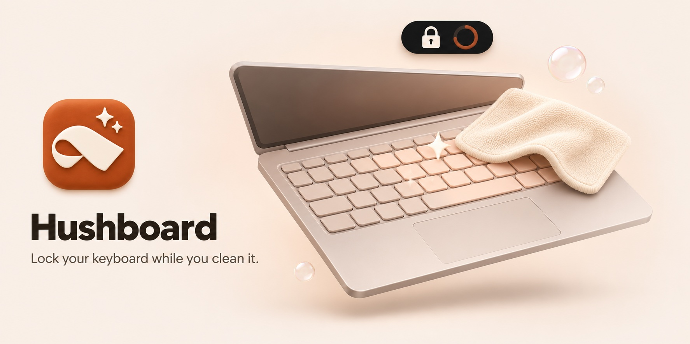

<p align="center">
  
</p>

<p align="center">
  Wipe your keys without typing into whatever's open.<br>
  Your mouse keeps working, and the way out is always on screen.
</p>

<p align="center">
  <a href="https://github.com/tekcify/hushboard/releases/latest"></a>
  <a href="https://github.com/tekcify/hushboard/releases/latest"></a>
  <a href="https://github.com/tekcify/hushboard/releases/latest"></a>
</p>

<p align="center">
  Free and open source (MIT) · <a href="docs/installing.md">Install guide</a> · <a href="CHANGELOG.md">What's new</a>
</p>

## How it works

1. Pick how long to lock: 30 seconds to 5 minutes, or until you unlock it yourself.
2. Press Lock. A 3-second countdown gives you time to change your mind.
3. Clean the keyboard. Each key you hit shows on screen, so you can see the lock is holding.
4. The keyboard comes back when the timer runs out or when you unlock it.

## Getting out is always easy

You can unlock at any moment in three ways:

- Hold the on-screen **Hold to unlock** button for 1.5 seconds.
- Press Ctrl + Alt + U (⌃⌥U on a Mac).
- Wait for the timer.

The pointer is never locked, and a timed lock can't run longer than 10 minutes. Nothing you type is stored, logged or sent anywhere. The key strip only shows key names, and only in memory.

## Where you'll find it

Hushboard sits where your system keeps small tools, out of the way until you need it.

| | When idle | While locked |
| --- | --- | --- |
| macOS | Menu bar icon, no Dock icon. Click for the panel, right-click for quick locks. | A black island grows out of the camera notch (a pill at the top centre on Macs without one). |
| Windows | Tray icon. Click for the panel, right-click for quick locks. | A pill floats at the top of every monitor. |
| Linux | Panel indicator with quick locks, plus a normal window. | A card in the middle of each monitor. |

Want the whole screen covered instead? Turn on **Cover the screen while locked**. The island's width, corner radius, size and layer are adjustable under **Island** in the panel. On macOS, **Detect cleaning** (off by default) can start a lock by itself when many keys are pressed at once, like a cloth wiping across them.

## First launch

Hushboard isn't signed by Apple or Microsoft yet, so your system warns you the first time you open it. The [install guide](docs/installing.md) shows how to get past that on each system. Once it's installed, Hushboard updates itself.

What each system asks for, once:

- macOS: your password to install a small keyboard helper, then switching it on under Input Monitoring. The app walks you through both.
- Windows: nothing.
- Linux: read access to your keyboards. Run `sudo usermod -aG input $USER`, then log out and back in.

<details>
<summary><strong>How the lock works on each system</strong></summary>

<br>

| OS | Method | What you allow once |
| --- | --- | --- |
| macOS | Keyboard helper (recommended): a small background service that takes exclusive control of the keyboard hardware through IOKit, like [Karabiner-Elements](https://github.com/pqrs-org/Karabiner-Elements). Unaffected by apps that turn on secure keyboard entry, and can lock the built-in keyboard alone. | Your Mac password to install it, then **Hushboard Keyboard Helper** in System Settings → Privacy & Security → Input Monitoring. |
| | *Fallback without the helper:* an event tap that drops key events. | Accessibility and Input Monitoring for Hushboard. Stops working while another app holds secure keyboard entry (Hushboard tells you which). |
| Windows | A low-level keyboard hook (`WH_KEYBOARD_LL`). Locks every keyboard at once. Ctrl + Alt + Del always gets through. | Nothing. |
| Linux | An exclusive grab (`EVIOCGRAB`) of each chosen keyboard device. Works on X11 and Wayland, and can lock the built-in keyboard alone. | Read access to `/dev/input`: `sudo usermod -aG input $USER`, then log out and in. |

The app keeps watching all of this. If a permission is switched off, a keyboard is plugged in, or something blocks the lock, the panel tells you straight away and the Lock button explains why it's disabled.

The macOS helper lives at `/Library/PrivilegedHelperTools/Hushboard Keyboard Helper.app` with the launch daemon `app.hushboard.keyhelper`. It only accepts connections from the logged-in user, releases the keyboard the moment the app disconnects, handles Ctrl + Alt + U itself, and never holds a lock longer than 30 minutes. To remove it:

```bash
sudo "/Library/PrivilegedHelperTools/Hushboard Keyboard Helper.app/Contents/MacOS/hushboard-keyhelper" --keyhelper-uninstall
```

</details>

<details>
<summary><strong>Build from source</strong></summary>

<br>

Hushboard is built with [Tauri](https://tauri.app) (Rust and a web UI). You need [Node.js](https://nodejs.org) 20+ and [Rust](https://rustup.rs) (stable), plus [Tauri's system dependencies](https://tauri.app/start/prerequisites/) for your OS.

```bash
git clone git@github.com:tekcify/hushboard.git
cd hushboard
npm install
npm run tauri dev
```

Release build: `npm run tauri build`.

To work on the UI in a browser with a simulated lock (nothing is locked), run `npm run dev` and open <http://localhost:1420/>. Add `?shell=panel`, `?helper=needs-approval` or `?helper=missing&secure=loginwindow` to preview states, and open `island.html?platform=windows&state=locked` for the island.

For macOS helper development, create a local signing certificate so macOS keeps the helper's permission across rebuilds: [docs/dev-signing.md](docs/dev-signing.md).

| Path | What's there |
| --- | --- |
| `crates/keylock` | The native lock, one file per OS, plus the macOS helper (`mac_helper.rs`, `mac_hid.rs`). Usable on its own. |
| `src-tauri/src/lib.rs` | The lock state machine (idle → arming → locked), the live system watcher, and the commands the UI calls. |
| `src-tauri/src/shell.rs` | Tray icon and menu, the tray panel, the island windows. |
| `src/` | The web UI: `main.ts` (panel/window), `island.ts`, `overlay.ts` (full-screen view), `tokens.ts` (design tokens to CSS). |
| `design-system/` | Hushboard's design system: tokens, component CSS and guidelines, and the icons (Nucleo Glass). |
| `docs/` | [Installing](docs/installing.md), [releasing](docs/releasing.md), [dev signing](docs/dev-signing.md). |

</details>

## Like it?

If Hushboard kept your keyboard quiet while you cleaned it, [give it a star on GitHub](https://github.com/tekcify/hushboard). It helps other people find it.

## Contributing

Bug reports, testing on your own hardware (Windows and Linux especially), code and design are all welcome. Start with [CONTRIBUTING.md](CONTRIBUTING.md), follow the [Code of Conduct](CODE_OF_CONDUCT.md), and report security issues privately as described in [SECURITY.md](SECURITY.md).

## License

[MIT](LICENSE) © Tekcify and the Hushboard contributors.
